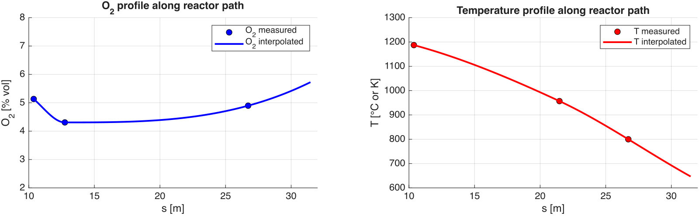
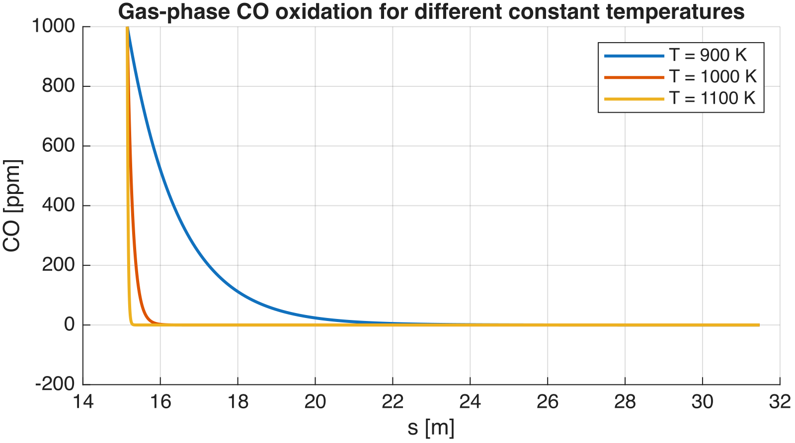
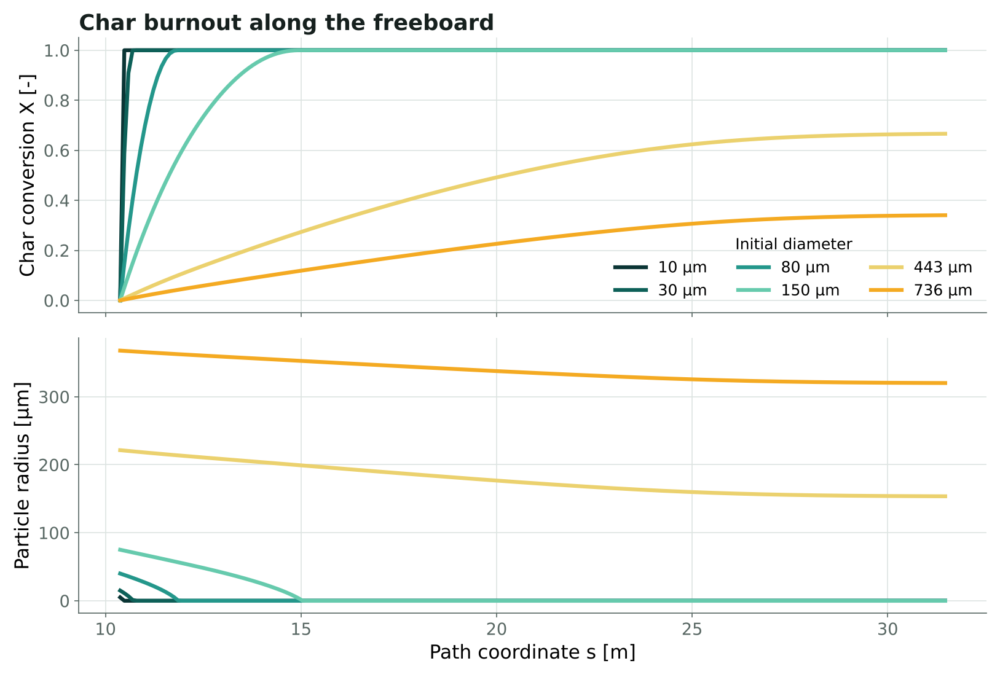
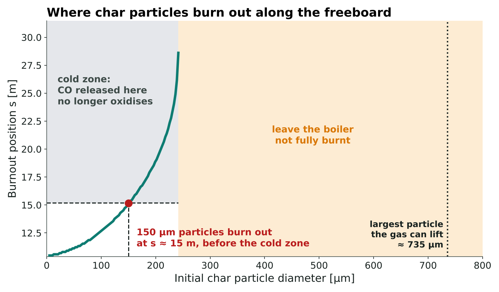

## Problem

The 33 MW Masnedø boiler in Denmark burns straw on a vibrating grate. It emits 200–400 ppm of CO in steady operation, much more than comparable units, and sharp CO peaks right after each grate vibration. Part of the burnout is evidently not completed before the flue gas reaches the colder upper part of the furnace.

Two mechanisms could explain it: **stratification**, where CO-rich gas meets the secondary air only when it is already too cold, and **entrained char**, where coarse fragments lifted by the vibrations burn too late. The aim was to test both against the measured temperature and oxygen profiles and to suggest operating changes.

## Model

- **Flow path**: the furnace sketch mapped onto a one-dimensional mean streamline, with flue-gas flow from a stoichiometric balance of the straw and a plug-flow residence time.
- **Measured profiles**: oxygen and temperature measurements along the freeboard, interpolated with a shape-preserving scheme.
- **Entrainment**: drag against gravity for spherical char particles, with Stokes and Schiller–Naumann correlations, giving the largest particle the gas can carry.
- **Char burnout**: shrinking-particle model with surface kinetics and external mass transfer in series.
- **Gas-phase CO**: Dryer–Glassman oxidation kinetics integrated along the path.

<figure>
  
  <figcaption>Measured oxygen (left) and temperature (right) along the freeboard path coordinate s.</figcaption>
</figure>

## Results

The gas spends about 7.2 s between the lower freeboard and the outlet. Effective CO oxidation needs temperatures above about 1000–1050 K: beyond s ≈ 14–16 m the oxidation time becomes longer than the residence time left, and CO is effectively frozen.

<figure>
  
  <figcaption>Gas-phase CO oxidation along the path at three constant temperatures: a 100–200 K drop slows burnout dramatically.</figcaption>
</figure>

Char particles up to about 150 µm burn out completely before the cold zone. The gas can lift particles up to about 735 µm, far larger than typical straw char, so coarse fragments thrown up by the grate vibrations are carried into the freeboard and release CO where it can no longer oxidise.

<figure>
  
  <figcaption>Char burnout and particle radius along the path for initial diameters from 10 to 736 µm.</figcaption>
</figure>

<figure>
  
  <figcaption>Where each particle size finishes burning. Up to about 150 µm the char burns out before the cold zone; larger particles finish in the cold zone or, above about 240 µm, leave the boiler not fully burnt, although the gas can lift particles up to about 735 µm.</figcaption>
</figure>

## Interpretation and recommendations

The steady 200–400 ppm baseline is most consistent with stratification, while the peaks after each vibration match the entrainment of coarse char. The proposed measures are better secondary-air penetration and a more stable hot zone, to mix the gas before it cools, and gentler or phased grate vibrations, to limit coarse-char release. Fast CO, O₂ and temperature signals, spatial traverses and char sampling during vibrations would separate the two mechanisms more sharply.

## Limitations

The one-dimensional, plug-flow description ignores recirculation and turbulent mixing, and the measured profiles are sparse. The model explains the mechanisms and their trends; it does not predict the CO level quantitatively.

The operating data and measurements of the Masnedø boiler were provided with DTU course 28244. The cover shows the char burnout map, recomputed from the model.

