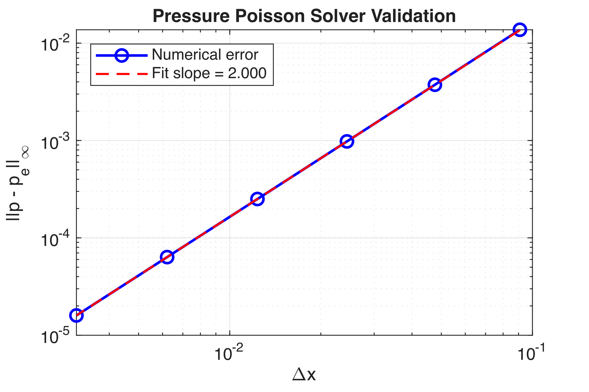
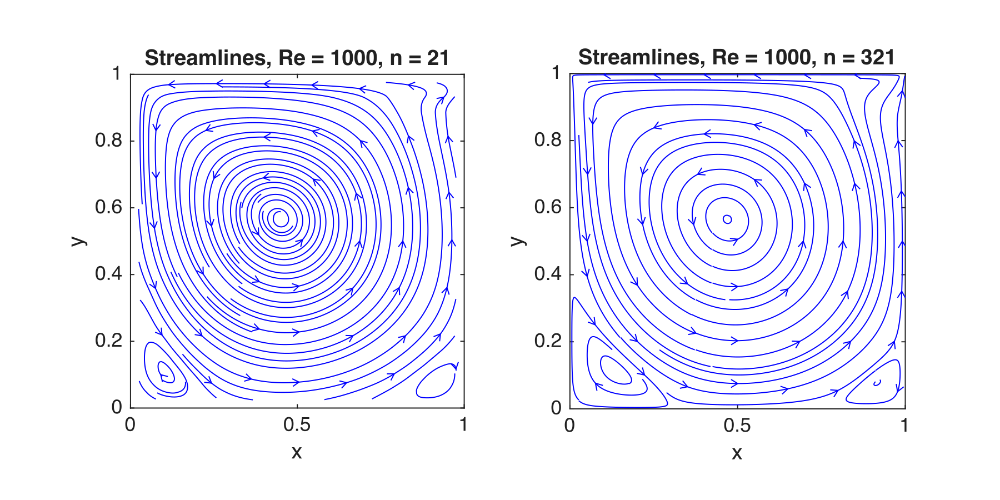
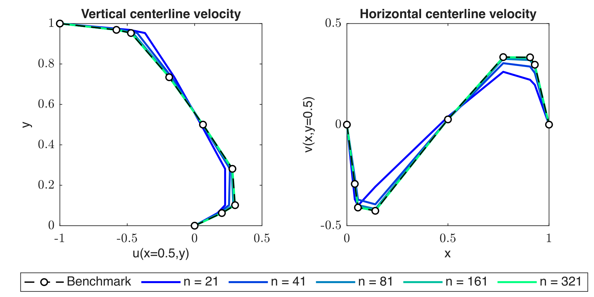
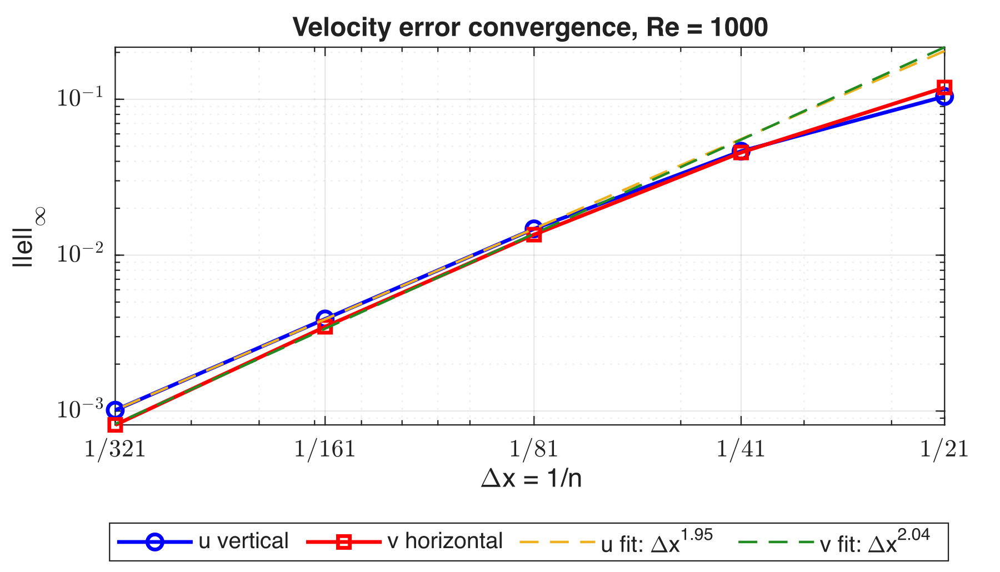
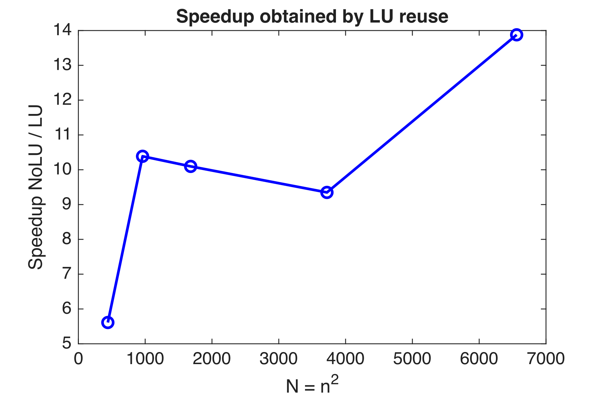

## Problem

The lid-driven cavity is the classic test case for incompressible flow solvers: a square box of fluid whose top wall slides at constant speed. The geometry is trivial, but the flow develops a primary vortex, corner eddies and thin boundary layers that become harder to resolve as the Reynolds number grows. That makes it a good way to check a solver end to end.

The goal was to write the solver myself, from the discretisation to the post-processing, and to prove that each part does what it should before trusting the full simulation.

## Method

- **Discretisation**: uniform staggered Cartesian grid, with velocities on the cell faces and pressure at the cell centres; central differencing of the convective and viscous fluxes.
- **Time integration**: explicit Euler, with time steps chosen from the convective and diffusive stability limits.
- **Pressure–velocity coupling**: a pressure Poisson equation enforces the divergence-free constraint at every step. With pure Neumann boundary conditions the pressure is fixed up to a constant, which is handled explicitly.
- **Continuity correction**: an optional discrete correction that removes the slow build-up of mass-conservation errors.
- **Efficiency**: the Poisson matrix does not change in time, so its reordered LU factorisation is computed once and reused at every step.

## Verification

Each building block was tested on its own against manufactured analytical solutions before running the full solver. The convergence order was estimated on the finest grids, where the error is in the asymptotic range.

| Quantity | Grids used for the fit | Estimated order |
|---|---|---|
| Convective–diffusive terms, $$H_1$$ | 81, 161, 321, 641 | 1.998 |
| Convective–diffusive terms, $$H_2$$ | 81, 161, 321, 641 | 1.998 |
| Pressure Poisson solver | 41, 81, 161, 321 | 2.000 |

All three match the second-order accuracy expected from the central finite-volume scheme.

<figure>
  
  <figcaption>Pressure Poisson solver: infinity-norm error against grid spacing for a manufactured solution.</figcaption>
</figure>

## Results at Re = 1000

At Re = 1000 the solver captures the primary vortex and the two secondary eddies in the bottom corners. The centreline velocity profiles converge to the benchmark data of Bruneau and Saad as the grid is refined from 21 to 321 cells per side.

<figure>
  
  <figcaption>Streamlines on the coarsest (n = 21) and finest (n = 321) grids.</figcaption>
</figure>

<figure>
  
  <figcaption>Vertical and horizontal centreline velocities against the benchmark, for five grid levels.</figcaption>
</figure>

On the finest grid the infinity-norm errors are about $$10^{-3}$$ for the velocities and below $$7 \times 10^{-4}$$ for the pressure profiles. The convergence rates from the three finest grids are 1.95 and 2.04 for the two velocity components, and between 1.67 and 2.00 for pressure; the vertical pressure profile converges more slowly because it depends on interpolation close to the walls.

<figure>
  
  <figcaption>Grid convergence of the centreline velocity errors at Re = 1000.</figcaption>
</figure>

## Performance

Reusing the LU factorisation of the Poisson matrix cut the cost of the pressure solve on every grid tested. On the finest grid of the efficiency study (81 × 81 cells) the run time dropped from 44.8 s to 3.3 s, a speed-up of 13.5; the average over all grids was about 10.

<figure>
  
  <figcaption>Speed-up of the reused LU factorisation over a standard sparse solve.</figcaption>
</figure>

## Limitations

Explicit Euler time stepping is simple and well suited to verification, but it is only conditionally stable: the time step shrinks quickly as the grid is refined or the Reynolds number increases. An implicit or semi-implicit scheme would be the natural next step.

Helper functions for mesh generation, polynomial fitting and plotting, and a small reference solution, were provided by Prof. Harry B. Bingham for DTU course 41317; everything else in the code was written by me. Benchmark data: Bruneau and Saad, <em>Computers &amp; Fluids</em>, 2006.

