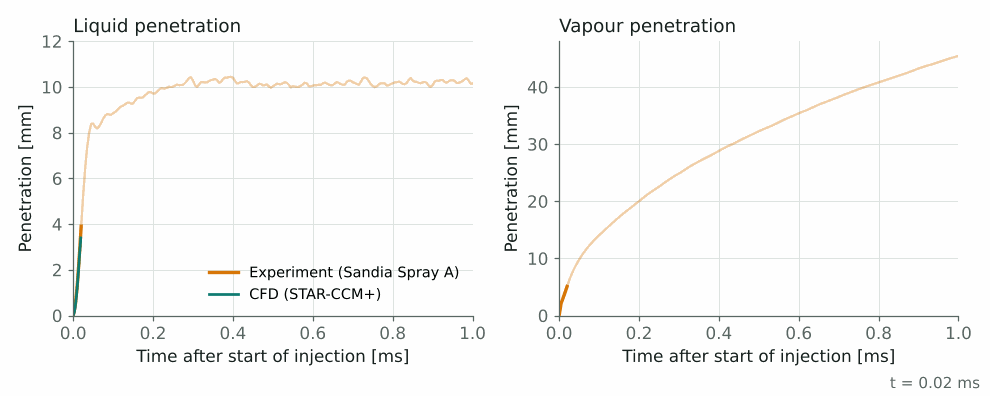
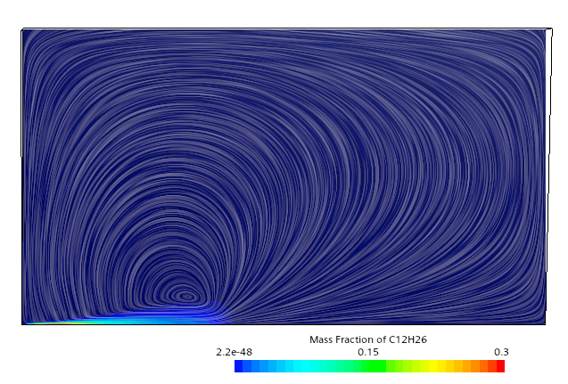
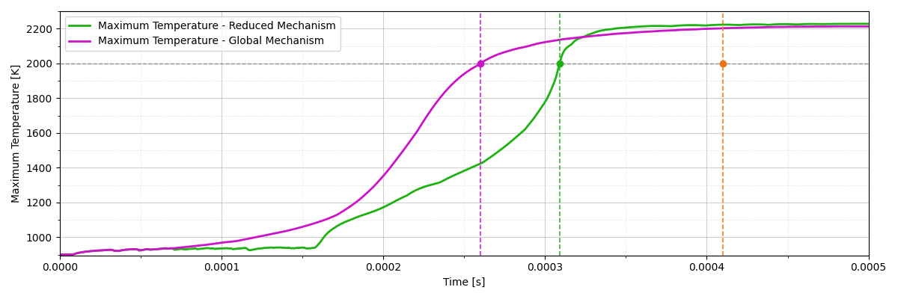

## Problem

Spray A is the reference case of the Engine Combustion Network led by Sandia National Laboratories: liquid n-dodecane is injected through a 84 µm nozzle into a constant-volume chamber at 900 K and about 60 bar, conditions typical of a diesel engine at the start of injection. Measured liquid and vapour penetration lengths and ignition delay are available, so the case is widely used to validate spray models.

The aim was to set up the simulation, reproduce the measurements in the inert case, understand how sensitive the result is to modelling choices, and then add combustion chemistry.

## Setup

- **Domain**: the cubic chamber reduced to a 4° axisymmetric wedge, with 432 × 60 cells and radial stretching down to 0.25 mm near the injector.
- **Spray**: Lagrangian parcels with a Rosin–Rammler droplet-size distribution at the injector, coupled with the Eulerian gas phase.
- **Turbulence**: standard k–ε model.
- **Reacting case**: a reduced n-dodecane mechanism (Yao, 54 species) compared with a one-step global mechanism.

## Validation: penetration lengths

The liquid length settles at about 10 mm after the initial transient, in line with the measurements; the small oscillations come from the statistics of the Lagrangian parcels. The vapour front follows the data closely up to about 0.4 ms and then slightly underpredicts it.

<figure>
  
  <figcaption>Liquid and vapour penetration over the first millisecond: simulation against Sandia measurements.</figcaption>
</figure>

<figure>
  
  <figcaption>Fuel vapour mass fraction with gas streamlines: the spray drives a large recirculation that entrains hot gas into the plume.</figcaption>
</figure>

## Sensitivity study

Each parameter was varied around the baseline while the others were kept fixed.

| Parameter | Values tested | Main effect |
|---|---|---|
| k–ε constant $$C_{1\varepsilon}$$ | 1.44, 1.52, 1.60 | Strongest effect on vapour penetration; 1.52 gives the best agreement with the data |
| Time step | 0.9, 1.0, 1.2 µs | Small effect; slightly longer penetration with the largest step |
| Radial cell size at the injector | 0.15, 0.25, 0.35 mm | Vapour front sensitive in the first 0.7 ms; 0.25 mm matches the data best |
| Droplet-size distribution | standard vs maximum diameter halved | Smaller droplets evaporate faster and shorten the liquid length |
| Parcel streams | 10 vs 100 000 | Many streams are needed to reproduce the imposed droplet-size law |

## Reacting case: ignition

Ignition was defined as the time when the maximum gas temperature reaches 2000 K. The reduced mechanism ignites at 0.31 ms and the global mechanism at 0.26 ms, against a measured ignition delay of 0.41 ms. The reduced mechanism is closer to the experiment and gives a more realistic flame development, at a higher cost per time step.

<figure>
  
  <figcaption>Maximum gas temperature for the reduced (Yao54) and global mechanisms; dashed lines mark the ignition times and the measured value.</figcaption>
</figure>

## What I learned

The validation depends as much on the modelling choices as on the physics: a single turbulence constant or the near-nozzle mesh can move the vapour front by several millimetres. Checking each choice against data, one at a time, is what makes the final setup credible.

Group project with Riccardo Padoan for DTU course 41316 Advanced CFD. Experimental data: Engine Combustion Network, Sandia National Laboratories. The simulation files are not included.

