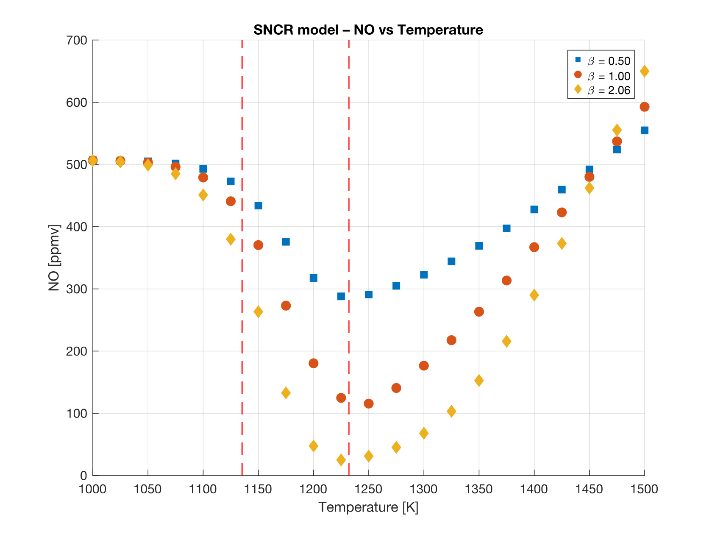
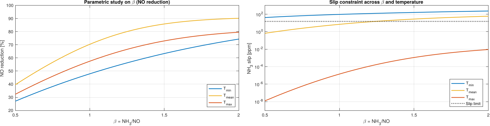
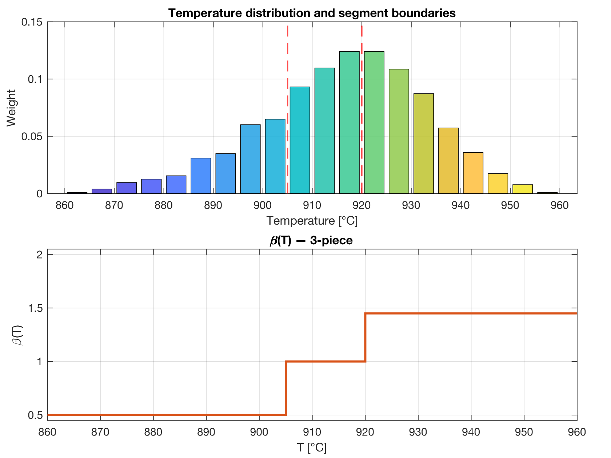
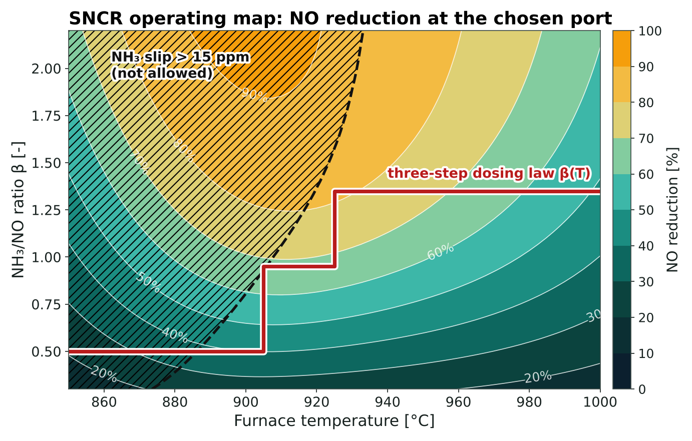
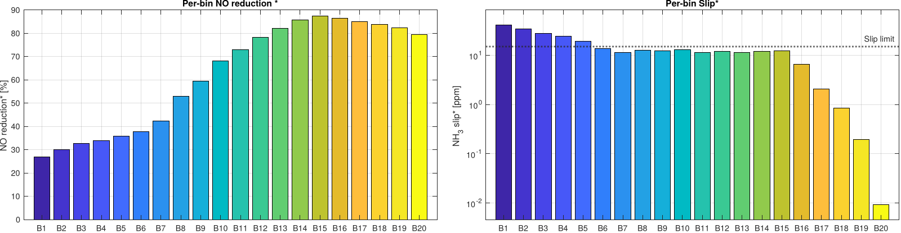

## Problem

Waste incinerators must keep their NOx emissions low, and in Sweden every kilogram of NO₂ emitted is taxed. SNCR reduces NO by injecting ammonia into the hot flue gas, but it only works in a narrow temperature window: too cold and the reactions are too slow, too hot and the ammonia burns to NO instead. Any ammonia that does not react leaves the stack as "slip", limited here to 15 ppm.

The SYSAV plant in Malmö burns about 13 t/h of municipal waste, about 40 MW of fuel input, with roughly 200 ppm of NO at the furnace exit. The questions were how much NO can be removed, from which existing furnace opening the ammonia should be injected, and how much ammonia to dose when the furnace temperature keeps fluctuating.

## Model

- **Chemistry**: the two-step global mechanism of Brouwer et al. (1996): NH₃ + NO → N₂ + products, and the competing NH₃ + O₂ → NO + products, both with modified Arrhenius rates $$k = A\,T^n e^{-E_a/RT}$$.
- **Reactor**: isothermal plug flow at 1 atm, with instant mixing of the ammonia at the injection point; the species balances form a stiff ODE system solved with `ode15s`.
- **Inlet gas**: flue-gas composition from a combustion balance of the waste (C, H, O and moisture content) at an excess-air ratio of 1.5.
- **Validation**: the model reproduces the temperature window of plug-flow reactor experiments from the literature, with the minimum NO between about 1130 and 1230 K.

<figure>
  
  <figcaption>Model validation: outlet NO against temperature for three NH₃/NO ratios β, with the reduction window marked.</figcaption>
</figure>

## Choosing the injection port and the dose

Four existing openings were compared through their residence time to the furnace exit, from about 250 ms at the throat to 925 ms at the upper over-fire-air port. The longest residence time gave the best result: about 70% NO reduction with 7 ppm of slip at the mean furnace temperature.

The NH₃/NO ratio β was then varied at the minimum, mean and maximum furnace temperatures. More ammonia helps up to a plateau, after which it only adds slip; the best β rises with temperature, from 0.5 at 862 °C to 2.0 at 959 °C.

<figure>
  
  <figcaption>NO reduction (left) and NH₃ slip (right) against β at the minimum, mean and maximum furnace temperatures.</figcaption>
</figure>

## Temperature-dependent dosing law

The measured furnace temperature fluctuates between 860 and 960 °C. Its distribution was split into 20 bins, the optimal β was found for each one under the slip limit, and the result was condensed into a three-step law β(T) that a plant control system can apply. The step positions and levels were optimised to maximise the expected NO reduction weighted by how often each temperature occurs.

<figure>
  
  <figcaption>Measured temperature distribution with the segment boundaries (top) and the resulting three-step dosing law β(T) (bottom).</figcaption>
</figure>

<figure>
  
  <figcaption>Operating map from the kinetic model: NO reduction over temperature and β, with the 15 ppm slip limit (dashed line) and the three-step dosing law (red). In the hatched area the NH₃ slip exceeds the limit.</figcaption>
</figure>

The map shows the trade-off behind the dosing law: higher β always removes more NO, but at low temperature the extra ammonia does not react and leaves as slip. The law follows the slip limit upwards as the furnace gets hotter; in the coldest bins, below about 885 °C, even the minimum dose slightly exceeds the limit, which is where the 4.3% of violations comes from.

| Indicator | Value |
|---|---|
| Expected NO reduction | about 68% |
| Mean NH₃ slip | 11.6 ppm |
| Share of time above the 15 ppm slip limit | 4.3% |
| Best injection port | upper over-fire air, left side |
| Dosing range | β from 0.5 to 2.0 |

<figure>
  
  <figcaption>NO reduction and NH₃ slip for each temperature bin with the optimal dose.</figcaption>
</figure>

## Limitations

Two global reactions, isothermal plug flow and perfect mixing make this a screening model: it predicts trends and good operating ranges rather than exact emissions. Mixing of the ammonia jet and temperature measurement errors are the main uncertainties.

The operating data of the SYSAV plant were provided with DTU course 28244.

