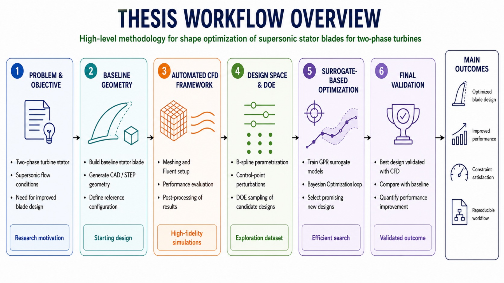
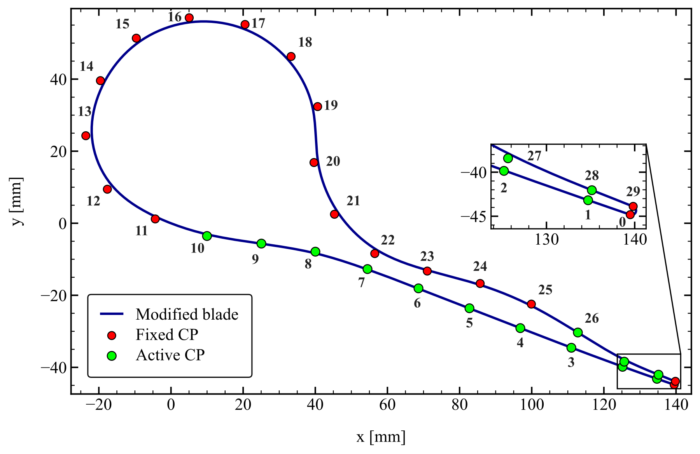
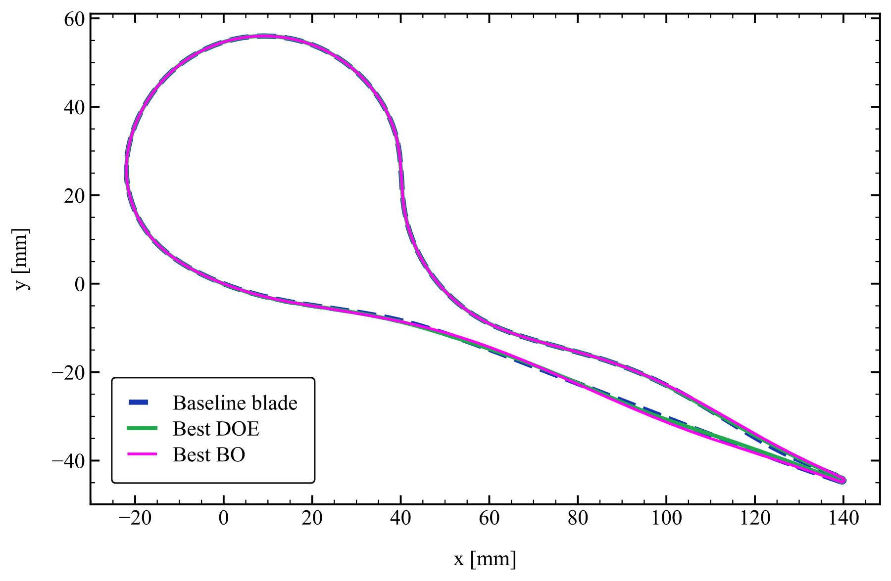
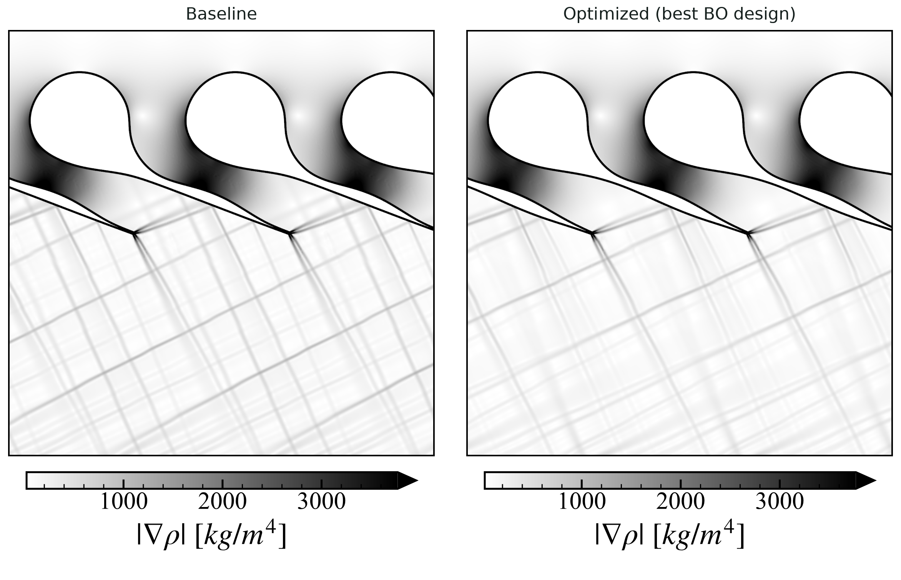
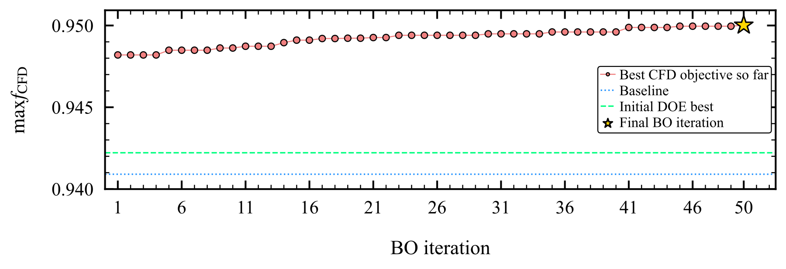
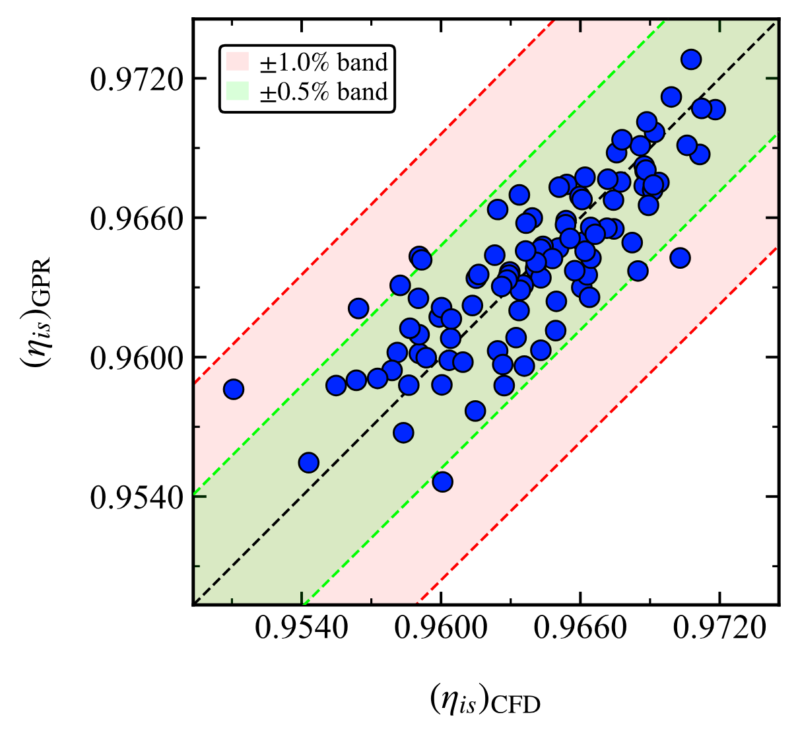

## Problem

In two-phase turbines the working fluid expands as a mixture of liquid and vapour. They are being studied for heat recovery and low-temperature power cycles, where a two-phase expansion can raise cycle efficiency, but their blades cannot simply be borrowed from steam or gas turbines: the speed of sound of the mixture is low, the flow in the stator becomes supersonic, and shocks and expansion waves at the trailing edge cost efficiency.

The thesis asked whether the shape of a supersonic stator blade working with two-phase cyclopentane could be improved automatically, with a limited number of CFD runs, while keeping the mass flow and the outlet flow angle at their design values. It was carried out in the Sustainable Thermal Power research group at DTU, within the Training42Phase project.

<figure>
  
  <figcaption>Overview of the workflow, from the baseline geometry to the CFD-validated optimum.</figcaption>
</figure>

## Method

- **Baseline geometry**: a supersonic nozzle profile designed with the method of characteristics, turned into a closed, periodic blade and rebuilt with B-splines.
- **Design space**: 13 control points of the B-spline can move within set bounds, so the shape changes only where it matters and the blade stays closed and meshable.
- **Fluid model**: a barotropic, homogeneous-equilibrium model of cyclopentane, in which density and the other properties depend on pressure alone along the expansion.
- **Automated CFD**: geometry, meshing and RANS simulations in ANSYS Workbench and Fluent, driven by Python scripts and journal files without manual steps.
- **Design of experiments**: 104 geometries sampled with a Latin hypercube (103 ran successfully) to train the first models.
- **Surrogates and optimisation**: three Gaussian-process models for efficiency, outlet angle and mass flow; Bayesian optimisation with a log expected-improvement acquisition proposes a new geometry, CFD evaluates it, and the models are retrained. 50 iterations, 153 CFD simulations in total.

<figure>
  
  <figcaption>B-spline parametrisation: only the active control points (green) move during the optimisation.</figcaption>
</figure>

## Results

The optimised blade raised the isentropic efficiency from 0.9700 to 0.9747. Expressed as residual loss, $$\zeta = 1 - \eta_{is}$$, this is a reduction of 15.7% compared with the baseline and 12.1% compared with the best design of the initial sampling. The mass flow stayed within 0.02% of its target and the outlet angle within 0.03%.

<figure>
  
  <figcaption>Baseline, best sampled design and optimised blade: the changes are local and concentrated on the suction side towards the trailing edge.</figcaption>
</figure>

<figure>
  
  <figcaption>Density gradient, a numerical schlieren image, for the baseline and the optimised blade. The main supersonic structure is kept; the waves leaving the trailing edge are weaker.</figcaption>
</figure>

The surrogates improved as the optimisation added data: the cross-validated R² of the efficiency and outlet-angle models rose from 0.66 and 0.76 to 0.92 and 0.91.

<figure>
  
  <figcaption>Best CFD-validated objective over the 50 Bayesian optimisation iterations, compared with the baseline and the best design of the initial sampling.</figcaption>
</figure>

<figure>
  
  <figcaption>Efficiency predicted by the Gaussian-process model against CFD, with ±0.5% and ±1% bands.</figcaption>
</figure>

## Limitations

The result is a validated local improvement within this design space, not a global optimum. The barotropic model assumes thermodynamic equilibrium, and the study is two-dimensional; non-equilibrium effects and three-dimensional flow would be the next steps.

The code and data of the thesis belong to the research project and are not published here.

